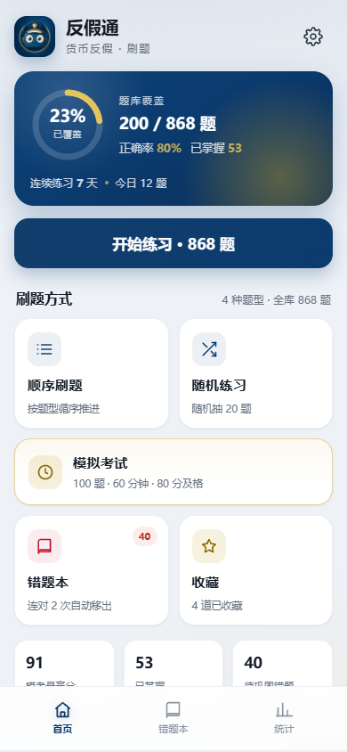
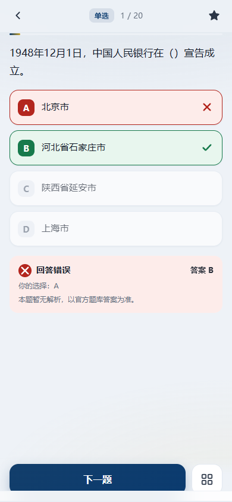
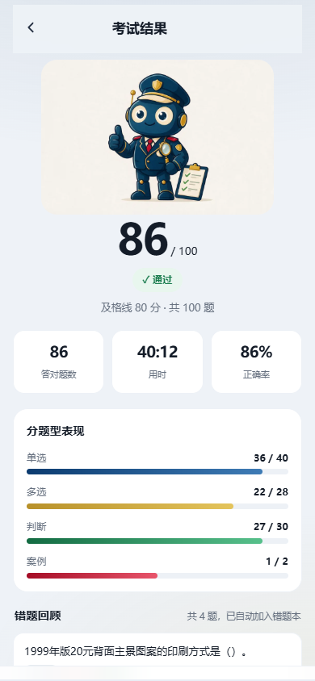
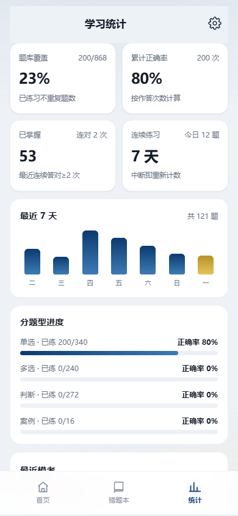
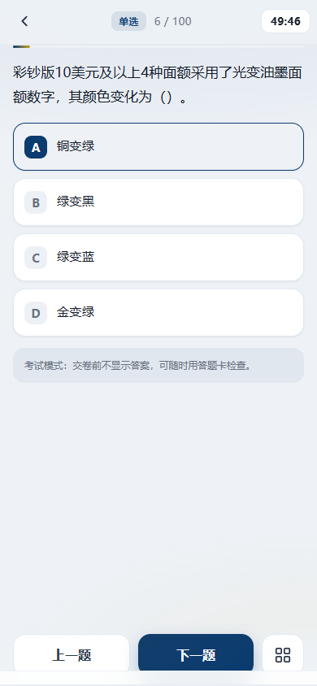
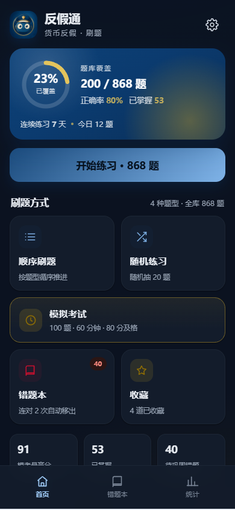

<div align="center">

# 反假通

**货币反假 868 题 · 单文件离线刷题应用**

面向银行柜面、清分、金库等现金从业人员的反假货币刷题工具。

[功能](#功能) · [截图](#截图) · [快速开始](#快速开始) · [从源码构建](#从源码构建)

</div>

> **非官方学习工具**：本项目与中国人民银行及相关机构无关。题库答案仅供参考，请以官方培训与考试口径为准。

---

## 简介

把训练、考试和复盘装进一个 HTML 文件：**不联网、不安装、不注册、不上传数据**。

- **单文件**：`反假通.html` 约 526 KB，双击即用，适合内网、无网和 U 盘分发
- **零依赖**：无框架、无 CDN、无后端、无字体请求，运行时 0 外部请求
- **全离线**：868 道题、6 张插画、样式与逻辑全部内联
- **数据本机**：进度、错题、收藏只写 `localStorage`，支持导出 / 导入 JSON
- **移动优先**：390 px 宽起排，适配安全区、深色模式与字号切换

> 适合考前突击、班组培训自测、错题回炉；不替代官方教材与面授培训。

## 功能

### 练习

- **顺序刷题**：按题型推进，自动从第一道未做过的题开始
- **随机练习**：随机抽 20 题，适合碎片时间
- **专项练习**：可只练单选 / 多选 / 判断 / 案例，题量 10 / 20 / 全部
- **断点续练**：退出、刷新、关浏览器后回来继续，进度不丢

### 模拟考试

- 100 题，按真实占比组卷：**单选 40 · 多选 28 · 判断 30 · 案例 2**
- 60 分钟倒计时，1 题 1 分，**80 分及格**
- 考试中不显示答案；答题卡可跳题；未答按错计
- 时间到自动交卷；中途退出可继续，倒计时不暂停

### 复盘

- **错题本**：答错自动收录，**连续答对 2 次自动移出**
- **收藏**：右上角星标，随时回看
- **答题卡**：对 / 错 / 未答 / 当前题一屏总览
- **统计**：题库覆盖、累计正确率、已掌握、连续天数、分题型进度、近 7 天、模考记录

### 体验

- 单选 / 判断点选即判，多选 / 案例提交后判分
- 正确、错误、漏选、应选未选分色标注，色盲也能靠 ✓ / ✗ 区分
- 深色 / 浅色 / 跟随系统，字号标准 / 大
- 设置内一键导出、导入、清空进度

## 截图

<p align="center">
  
  
  
</p>

<details>
<summary>更多界面（统计 / 考试 / 深色模式）</summary>
<br>
<p align="center">
  
  
  
</p>
</details>

## 快速开始

### 方式一：直接打开（推荐）

1. 下载仓库中的 [`反假通.html`](./反假通.html)
2. 双击，用 Chrome / Edge / Safari 打开
3. 开始刷题，进度自动保存在本机

### 方式二：GitHub Pages（手机访问）

1. 仓库 **Settings → Pages**
2. Source 选择 **Deploy from a branch**，分支 `main`，目录 `/ (root)`
3. 打开 `https://<你的用户名>.github.io/<仓库名>/`

根目录的 `index.html` 会自动跳转到应用；也可以直接访问 `.../反假通.html`。

### 方式三：本地起一个静态服务

```bash
python -m http.server 8000
# 打开 http://localhost:8000/反假通.html
```

> 手机使用建议走 Pages 或本地服务。iOS 的「文件」App 直接打开 HTML 时，脚本与本地存储可能受限。

## 题库与规则

| 题型 | 数量 | 判分规则 |
|---|---:|---|
| 单选 | 340 | 选中即判，答案唯一 |
| 多选 | 240 | 与答案集合完全一致才得分，漏选 / 多选均 0 分 |
| 判断 | 272 | A = 正确，B = 错误，选中即判 |
| 案例 | 16 | 情景不定项，其中 3 题单选、13 题多选，提交后判分 |

- 合计 **868 题**，无重复题干
- 考试抽题会排除标记为「答案存疑」的题目，练习中仍可作答并给出提示
- 题库原文**没有解析**，所以答错只展示「你的选择 / 正确答案 / 选项全文」，不生成、不编造解析

### 已知数据问题

**多选第 169 题**：原始答案为 `ABCDF`，但选项只有 A–E。本项目没有擅自改写答案，而是：

- 在题目上标记「答案存疑 · 已排除出模拟考」
- 练习判分按可见选项（A–D）计算，并提示核对原文
- 建议题库维护者确认后修正 `app/questions.json`

## 数据与隐私

- 所有数据保存在浏览器 `localStorage`，键名 `fj.v1`
- 无账号、无接口、无统计埋点，数据不会离开设备
- 换设备：**设置 → 导出进度** 生成 JSON，在新设备 **导入进度** 即可
- 清空：设置 → 清空全部进度（题库本身不受影响）
- 浏览器隐私模式、清理站点数据会导致进度丢失，重要进度请先导出

## 技术实现

- 单个 HTML：内联 CSS、JS、题库 JSON、WebP 插画（Base64）
- 原生 JavaScript，无框架、无构建产物依赖；题库在构建期编译进页面
- 图标为内联 SVG；插画为 AI 生成后压缩为 WebP
- 主题基于 CSS 变量；`prefers-color-scheme` 跟随系统
- 适配 `env(safe-area-inset-*)`，支持 iPhone 刘海屏与底部横条
- 建议使用 Chrome / Edge 111+、Safari 16.2+、Firefox 113+

### 内置自检

在文件地址后加 `?selftest=1`，会运行 18 项自检：题库数量、题型配比、答案边界、判分、组卷、错题规则、本地存储、页面渲染等。

```text
反假通.html?selftest=1
```

开发预览还支持 `?demo=home|quiz|result|stats|wrong|exam|settings` 注入演示数据（不会写入真实进度）。

### 关于 PWA

页面内嵌了 manifest、主题色和 Apple 主屏 meta，可离线打开，也可「添加到主屏幕」。但**单文件无法注册 Service Worker**，因此不满足 Chrome 的完整安装条件；如需可安装的 PWA，需要拆出 `sw.js` 并托管在 HTTPS 下——这与「单文件」目标互斥，暂未包含。

## 项目结构

```text
.
├── 反假通.html              # 单文件应用（发布主体）
├── index.html               # GitHub Pages 入口（跳转到应用）
├── README.md
├── LICENSE
├── screenshots/             # README 截图
└── app/                     # 源码与构建脚本
    ├── template.html        # HTML 骨架
    ├── styles.css           # 样式
    ├── app.js               # 应用逻辑
    ├── questions.json       # 868 题结构化数据
    ├── assets/              # 图标、吉祥物、插画
    ├── build.py             # 打包为单文件
    └── parse_bank.py        # docx 题库 → questions.json
```

## 从源码构建

环境：Python 3.9+、[Pillow](https://pypi.org/project/Pillow/)。

```bash
pip install pillow
python app/build.py
```

输出覆盖仓库根目录的 `反假通.html`。输入包括 `app/questions.json`、`app/assets/`、`app/template.html`、`app/styles.css`、`app/app.js`。

### 重新生成题库数据（可选）

需要原始 docx（**仓库不包含**）和 python-docx：

```bash
pip install python-docx
python app/parse_bank.py "path/to/题库.docx"
```

解析器按当前题库的版式编写：节标题为「单选 / 多选 / 判断 / 案例」，选项以 `A ` 开头，答案行为 `正确答案： B`。若题库换版，请先调整 `app/parse_bank.py` 中的正则与校验。

### 替换插画

直接替换 `app/assets/` 下的 `mascot.webp`、`great.webp`、`ok.webp`、`bad.webp`、`empty.webp` 与 `icon.jpg`，再执行 `python app/build.py`。

## 已知限制

- **无解析**：题库原文没有解析，本项目不生成内容
- **无云同步**：换设备靠导出 / 导入 JSON
- **无排行榜 / 社交**：有意不做，避免把学习工具做成打卡产品
- **单文件不是完整 PWA**：详见上文「关于 PWA」
- **题库版权**：题目文字版权归原权利人，公开分发前请确认授权（见下文）

## 版权与免责声明

- **程序代码**（HTML / CSS / JS / 构建脚本）采用 [MIT License](./LICENSE) 发布
- **题库文字内容**（题目、选项、答案）版权归原权利人所有，**不适用 MIT 许可**，也不在本仓库的授权范围内
- 本仓库**不包含原始 docx**；题目文字内嵌于构建产物中，仅用于学习与技术演示
- 本项目与中国人民银行、任何银行或培训机构无隶属关系；答案与判分规则仅供参考
- 请勿将本项目用于商业售课、收费培训或其他侵犯题库版权的用途

## 更新日志

### v1.0.0 — 2026-11

- 868 题入库：单选 340 / 多选 240 / 判断 272 / 案例 16
- 顺序、随机、专项、错题、收藏、模拟考试
- 答题卡、倒计时自动交卷、断点续练
- 错题本连对 2 次移出、统计与近 7 天图表
- 深色模式、字号切换、进度导出 / 导入
- 单文件构建、18 项内置自检

## 致谢

- 产品、体验、前端与测试方案由 **产品经理、UX 架构师、前端开发者、验收测试工程师** 四位专家评审
- 插画由 **seedance 生图模型** 生成，经裁切、压缩后内嵌
- 题库由项目发起人提供，版权归原权利人

---

如果这个项目对你有帮助，欢迎 Star；题库修订与功能建议请提 Issue。
